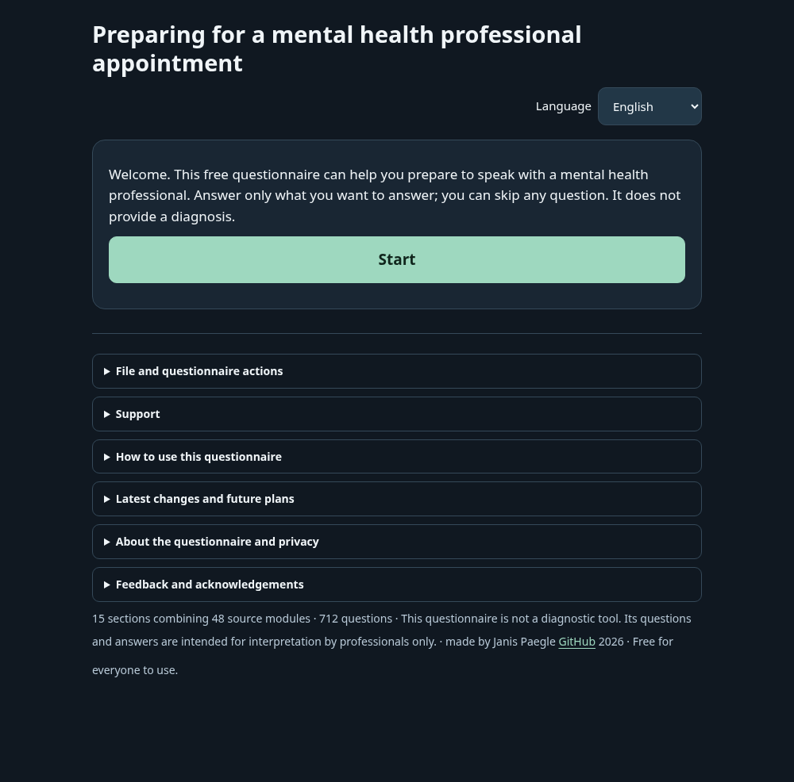

# Mental health questionnaire — four languages

[](https://github.com/janisp123/mental-health-questionnaire/actions/workflows/questionnaire-checks.yml)

**Current version: v0.2.4 · Latvian / English / Russian / Ukrainian · 712 questions · 15 optional sections.**

Free offline questionnaire for adults preparing for a mental-health appointment. All four languages are included in one HTML file. Latvian is the reference and initial language. It does not diagnose or calculate a screening score.

**[Open the current review folder](https://drive.google.com/drive/folders/1BUlc5W7tRw06JOUE250wCuTe-1ick9xb)** · [Current files and checksums](MH_Public_version/manifest.json) · [Version snapshot](https://github.com/janisp123/mental-health-questionnaire/tree/review/v0.2.4-guide-instructions)



## What the current version includes

- One shared application with complete LV/EN/RU/UK question and interface packs.
- Optional sections, medication details, and explicit progress-file download/import, including older three-language progress files.
- A clinician report language chosen independently of the questionnaire language, plus a separate project-feedback report.
- Phone layout fixes and preservation of unfinished feedback when switching languages.
- Repeatable HTML/PDF/ZIP packaging, source/checksum records, main-based CI, and archived rollback packages.

## Technical overview

| Area | Technologies and approach |
|---|---|
| Application | Plain HTML, CSS and JavaScript; focused screens, state transitions and report renderers. |
| Content and languages | JSON question data and validated translation packs, with stable question IDs and answer codes. |
| Build and packaging | Python, ReportLab, embedded fonts and checksum manifests; one self-contained offline HTML plus a PDF guide and ZIP. |
| Verification | JavaScript component tests, Python source/package checks, Playwright/Chromium browser journeys and responsive layout sweeps. |
| Delivery | GitHub Actions, short-lived branches/PRs, versioned review snapshots and readback-verified Drive updates. |

The technical work addresses three practical problems: keeping sensitive answers on the user's device, maintaining consistent question/answer identity across languages, and preserving older progress files while the interface evolves. Separate answer and feedback reports help keep reviewer comments out of the clinician document. Repeatable packaging and current-source verification help prevent distributing stale files.

## Project ownership and AI-assisted implementation

Janis Paegle leads the product concept, requirements, prioritization, review of generated outputs, QA decisions and project coordination. Application code, tooling, tests and documentation have been generated and revised with AI/Codex assistance under that direction.

This repository shows the specification, iteration and verification of an AI-assisted software product. The source history and [module contracts](docs/FEATURE_DEVELOPMENT.md) make the implementation and its boundaries inspectable. Human language/clinical review and physical-device verification remain separate requirements.

## Current files

- [Questionnaire HTML](MH_Public_version/187_Questionnaire_FULL_712Q_LV_EN_RU_UK_v0.2.4_REVIEW_BUILD.html)
- [Four-language PDF guide](MH_Public_version/188_README_LV_EN_RU_UK_v0.2.4_REVIEW_BUILD.pdf)
- [Google Drive review folder](https://drive.google.com/drive/folders/1BUlc5W7tRw06JOUE250wCuTe-1ick9xb)

Download the HTML and open it in your browser; Drive/GitHub preview is not the questionnaire. It runs offline and sends no answers. Download progress explicitly to continue later. Clinician reports and project-feedback PDFs are separate. Recovery files may contain sensitive information; keep and share them carefully.

## Development

`main` is the only active product source. Create short-lived branches from main. Older develop/candidate branches and [archived packages](archive/three-language/v0.2.0/README.md) are historical. Legacy `downloads/` paths remain for existing links.

```sh
python -m pip install -r tools/review-requirements.txt playwright
python -m playwright install chromium
python tools/run_checks.py
python tools/build_questionnaire.py
python tools/build_review_package.py --output-dir dist/review-0.2.4
python tools/verify_review_package.py dist/review-0.2.4 --with-zip
```

The normal HTML output is `dist/QUESTIONNAIRE_LV_EN_RU_UK_NOT_RELEASED.html`. Package destinations are never overwritten. CI runs the same checks on PRs to main and on main, then uploads the matching four-language package.

Read [feature/module contracts](docs/FEATURE_DEVELOPMENT.md), [architecture](docs/QUESTIONNAIRE_ARCHITECTURE.md), [release policy](docs/RELEASE_POLICY.md) and [current checkpoint](docs/WORK_CHECKPOINT.md) before working. For a managed browser that blocks file navigation, explicitly use `--load-mode memory` and record that limitation.

## Review and contribution

This is a technical-review project. Human language review, clinical review and physical-device verification remain separate requirements. Main adoption does not establish clinical validation. Anyone may use the questionnaire for free, including clinicians during appointments. Source/content reuse terms are separate: no general license has been granted.

Use synthetic data in public issues/tests; never post patient answers or recovery files. Project feedback: janis.paegle.email@gmail.com. See [contribution guidance](CONTRIBUTING.md) and the [future-ideas parking lot](docs/FUTURE_IDEAS.md), which is not an approved feature roadmap.
