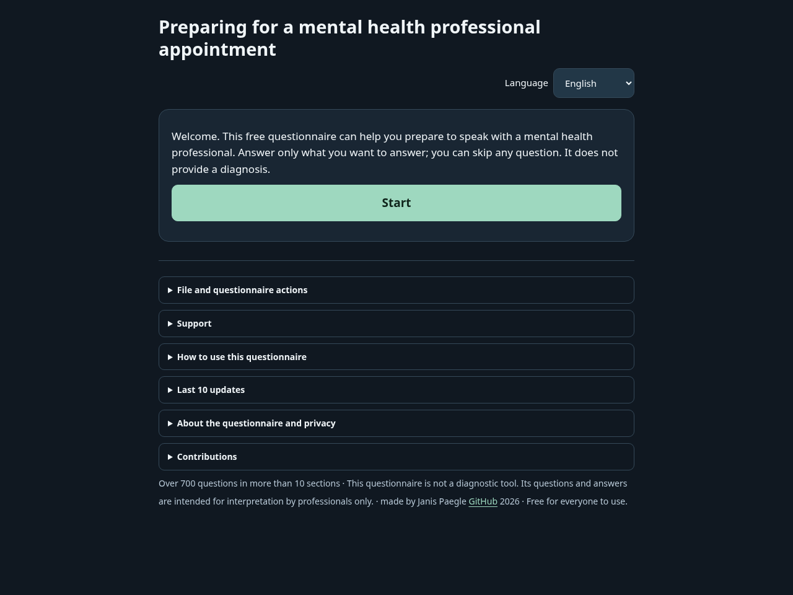

# Multilanguage mental health questionnaire

[](https://github.com/janisp123/mental-health-questionnaire/actions/workflows/questionnaire-checks.yml)

**Current version: v0.2.17 · Latvian / English / Russian / Ukrainian · 718 questions · 15 optional sections.**

[Open questionnaire in your browser](https://janisp123.github.io/mental-health-questionnaire/questionnaire/) — no installation or manual download. You can also use the Drive download below for offline use. Both options use the same questionnaire; save a progress file manually before closing or reloading to continue later.

Free offline questionnaire for adults preparing for a mental-health appointment. All available languages are included in one HTML file. Latvian is the reference and initial language. It does not diagnose or calculate a screening score.

## Download and open

**[Download from Google Drive](https://drive.google.com/drive/folders/1BUlc5W7tRw06JOUE250wCuTe-1ick9xb)**

1. In the Drive folder, choose **Download** for the file ending in **`.html`**. The Drive preview and GitHub source viewer do not run the questionnaire.
2. Open the downloaded HTML file in a browser. On a phone, find it in **Files → Downloads** and use **Open with → browser** if offered.
3. Choose your language and begin. To continue later, use the app's progress-file download and keep the saved file.

The same Drive folder contains the **`.pdf`** guide. Download it there and open it in a PDF viewer.

If the HTML appears as code, it is open in a source/text viewer. Choose a browser instead. If your phone offers no browser for local HTML files, use a desktop browser; physical-phone compatibility testing remains pending.

The questionnaire runs offline and sends no answers. Clinician reports and project-feedback PDFs are separate. Downloaded progress files may contain sensitive information; keep and share them carefully.



## What the current version includes

- One shared application with complete LV/EN/RU/UK question and interface packs.
- Per-question email preparation/copy and save-for-later feedback; medical answers are excluded and email sending stays under your control.
- Focused questions about everyday coordination, speech clarity and rare stuttering, alongside the preserved original question bank.
- An optional safety-section question about how responsibilities and people depending on you might affect thoughts of ending your life.
- Independent action-history and timing questions distinguish wanting to die, mixed feelings, indifference to survival and not wanting to die, without automatically labelling an experience a suicide attempt.
- Optional sections, medication details, and explicit progress-file download/import, including older progress files.
- A clinician report language chosen independently of the questionnaire language, plus a separate project-feedback report. Provided answers, including negative, uncertain and declined responses, remain in the report.
- Clinician responses ordered by draft review priority, keeping related context together; this is not a clinical risk score.
- Confirmed restart and public-link sharing from the clinician preview; sharing excludes answers, saved progress and feedback.
- A Contributions section that remains visible while awaiting permission to list contributors.
- Country-neutral instructions for finding a local helpline, with local emergency guidance first.
- A multilanguage explanation of the panic question’s “peak” timing, without changing its answers.
- Phone layout fixes and preservation of unfinished feedback when switching languages.
- Repeatable HTML/PDF/ZIP packaging, source/checksum records, main-based CI, and archived rollback packages.

Landing page languages: [English](https://janisp123.github.io/mental-health-questionnaire/) · [Latviešu](https://janisp123.github.io/mental-health-questionnaire/lv/) · [Русский](https://janisp123.github.io/mental-health-questionnaire/ru/).

## Questions about depression before an appointment

If you are looking for a free offline questionnaire to help describe low mood before seeing a psychiatrist or therapist, this tool includes questions about mood, interest, sleep, energy, concentration and daily-life impact. You can choose relevant sections and prepare a PDF summary.

It is an appointment-preparation aid, **not a validated depression screening test**. It does not diagnose depression, calculate a depression score or rule out a condition. Its diagnostic accuracy has not been established. You can seek professional help without completing it.

**[Read the public questionnaire overview](https://janisp123.github.io/mental-health-questionnaire/)** for depression-related appointment questions, download instructions and privacy details. [Publication/indexing instructions](docs/discovery-preview/LAUNCH.md) record the hosting and search-verification limits.

## Technical overview

| Area | Technologies and approach |
|---|---|
| Application | Plain HTML, CSS and JavaScript; focused screens, state transitions and report renderers. |
| Content and languages | JSON question data and validated translation packs, with stable question IDs and answer codes. |
| Build and packaging | Python, ReportLab, embedded fonts and checksum manifests; one self-contained offline HTML plus a PDF guide and ZIP. |
| Verification | JavaScript component tests, Python source/package checks, Playwright/Chromium browser journeys and responsive layout sweeps. |
| Delivery | GitHub Actions, short-lived branches/PRs, versioned review snapshots and readback-verified Drive updates. |

The technical work addresses three practical problems: keeping sensitive answers on the user's device, maintaining consistent question/answer identity across languages, and preserving older progress files while the interface evolves. Separate answer and feedback reports help keep reviewer comments out of the clinician document. Repeatable packaging and current-source verification help prevent distributing stale files.

## Project ownership and AI-assisted implementation

Janis Paegle leads the product concept, requirements, prioritization, review of generated outputs, QA decisions and project coordination. Application code, tooling, tests and documentation have been generated and revised with AI/Codex assistance under that direction.

This repository shows the specification, iteration and verification of an AI-assisted software product. The source history and [module contracts](docs/FEATURE_DEVELOPMENT.md) make the implementation and its boundaries inspectable. Human language/clinical review and physical-device verification remain separate requirements.

## Source and package records

- [Browse the application source](src/app/)
- [Current package files, source revision and checksums](MH_Public_version/manifest.json)
- [Version snapshot](https://github.com/janisp123/mental-health-questionnaire/tree/review/v0.2.17)

## Development

`main` is the only active product source. Create short-lived branches from main. Older develop/candidate branches and [archived packages](archive/three-language/v0.2.0/README.md) are historical. Legacy `downloads/` paths remain for existing links.

```sh
python -m pip install -r tools/review-requirements.txt playwright
python -m playwright install chromium
python tools/run_checks.py
python tools/build_questionnaire.py
python tools/build_review_package.py --output-dir dist/review-0.2.4
python tools/verify_review_package.py dist/review-0.2.4 --with-zip
```

The normal HTML output is `dist/QUESTIONNAIRE_LV_EN_RU_UK_NOT_RELEASED.html`. Package destinations are never overwritten. CI runs the same checks on PRs to main and on main, then uploads the matching multilanguage package.

Read [feature/module contracts](docs/FEATURE_DEVELOPMENT.md), [architecture](docs/QUESTIONNAIRE_ARCHITECTURE.md), [release policy](docs/RELEASE_POLICY.md) and [current checkpoint](docs/WORK_CHECKPOINT.md) before working. For a managed browser that blocks file navigation, explicitly use `--load-mode memory` and record that limitation.

## Review and contribution

This is a technical-review project. Human language review, clinical review and physical-device verification remain separate requirements. Main adoption does not establish clinical validation. Anyone may use the questionnaire for free, including clinicians during appointments. Source/content reuse terms are separate: no general license has been granted.

Use synthetic data in public issues/tests; never post patient answers or recovery files. Project feedback: janis.paegle.email@gmail.com. See [contribution guidance](CONTRIBUTING.md) and the [future-ideas parking lot](docs/FUTURE_IDEAS.md), which is not an approved feature roadmap.
